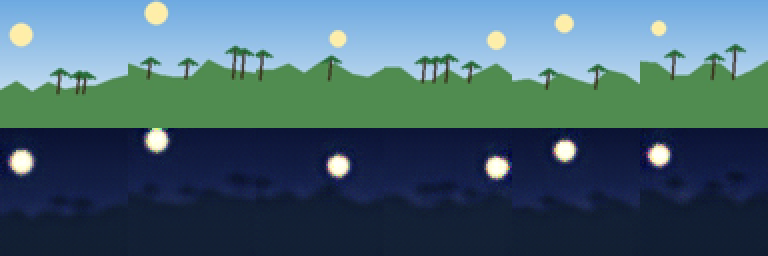

# KeralaGAN

**Shot on a phone. Painted like a temple wall.**

KeralaGAN is a CycleGAN that learns Kerala styles from *unpaired* images and repaints any photo in one pass:

| Translation | Domain A | Domain B |
|---|---|---|
| Summer → Monsoon | sunny Kerala landscapes | rain and heavy cloud |
| Day → Night | streets, temples and backwaters by day | the same kinds of places after dark |
| Photo → Kerala mural | photos of figures and dancers | Kerala mural paintings |

Project page: `docs/index.html` (published with GitHub Pages)
Demo: Gradio app in `app.py` (deployable to Hugging Face Spaces)

> **Status:** code complete and tested; datasets being collected. Results and FID scores will be added here after training.

---

## How it works

CycleGAN trains two generators and two discriminators at once:

- `G(A→B)` repaints a photo in the target style; `G(B→A)` paints it back.
- `D_A` and `D_B` are 70×70 **PatchGAN** critics that score every patch as real or fake, which suits texture and style.
- **Cycle-consistency loss** (A → B → A must return the original) keeps the content intact, so no paired data is needed.

| Part | Choice |
|---|---|
| Generator | ResNet encoder–decoder, 9 residual blocks (6 for 128 px), instance norm, reflection padding |
| Discriminator | 70×70 PatchGAN, LeakyReLU 0.2 |
| Losses | least-squares GAN + cycle (λ = 10) + identity (λ = 5) |
| Optimiser | Adam, lr 2e-4, β = (0.5, 0.999); constant for half the epochs, then linear decay |
| Stabilisers | pool of 50 past fakes, random crop + flip |
| Training | 256 × 256, batch 1, ~100 epochs on a Colab/Kaggle T4, optional mixed precision |

Paper: Zhu, Park, Isola and Efros, *Unpaired Image-to-Image Translation using Cycle-Consistent Adversarial Networks*, ICCV 2017.

---

## Repository

```
keralagan/            the package
  models.py           Generator, Discriminator, ImagePool
  data.py             unpaired dataset + transforms
  train.py            training CLI (resume, AMP, samples, CSV loss log, atomic checkpoints)
  translate.py        inference CLI + helpers used by the app
scripts/
  make_patches.py     cut big mural photos into training patches
  extract_frames.py   pull frames from your own videos (ffmpeg)
  prepare_dataset.py  clean, de-duplicate, resize, split into trainA/B testA/B
  make_toy_dataset.py synthetic day/night data to test the pipeline
  evaluate_fid.py     FID score + before/after grid
  export_generator.py shrink a checkpoint to one fp16 generator (~22 MB)
  build_space.py      assemble a Hugging Face Space folder
notebooks/
  train_colab.ipynb   end-to-end training on a free GPU
app.py                Gradio demo
docs/index.html       project website
data/README.md        how to collect each dataset; sources.csv for licences
tests/                pytest suite (runs on CPU in ~20 s)
```

---

## Quick start

```bash
git clone https://github.com/abhinavrenjithg-sys/KeralaGAN.git
cd KeralaGAN
pip install -r requirements.txt
pytest -q                                   # sanity check, CPU, ~20 s
```

### 1. Try the whole pipeline on toy data (no downloads)

```bash
python scripts/make_toy_dataset.py --out data/toy --n 120
python -m keralagan.train --data data/toy --epochs 10 --size 64 --n_blocks 4 --workers 0
python -m keralagan.translate --ckpt checkpoints/toy/latest.pt --input data/toy/testA --out results/toy --side_by_side
```

### 2. Build a real dataset

See [`data/README.md`](data/README.md). In short:

```bash
python scripts/make_patches.py --src raw/murals_full --dst raw/mural_patches
python scripts/prepare_dataset.py --a raw/people --b raw/mural_patches --name mural
```

### 3. Train (GPU)

Open `notebooks/train_colab.ipynb` in Colab, or:

```bash
python -m keralagan.train --data data/monsoon --epochs 100 --amp --resume --out /path/on/drive
```

Every epoch writes `samples/<name>/epoch_XXX.png` (rows: real A, fake B, real B, fake A),
`checkpoints/<name>/latest.pt`, and losses to `logs/<name>.csv`.

### 4. Evaluate

```bash
python scripts/evaluate_fid.py --data data/monsoon --ckpt checkpoints/monsoon/latest.pt
```

### 5. Demo app

```bash
python scripts/export_generator.py --ckpt checkpoints/monsoon/latest.pt --out weights/monsoon_G_AB.pt
python app.py                               # http://127.0.0.1:7860
python scripts/build_space.py               # -> space/, push it to a Hugging Face Space
```

---

## Pipeline check (toy data)

Before collecting real images, the full pipeline was run on the synthetic day/night set from
`scripts/make_toy_dataset.py`: 80 images per side, 64 px, 10 epochs on a laptop-class CPU (~7 min).
Losses fell steadily (generator 24.0 → 1.8, cycle 1.22 → 0.08) and the model learned the mapping:
suns became moons and skies darkened, while hills and tree positions stayed put.



This is a sanity check on fake data, not a result. Real results go in the table below.

## Results

| Translation | Epochs | FID ↓ | Before / after |
|---|---|---|---|
| Summer → Monsoon | — | — | coming soon |
| Day → Night | — | — | coming soon |
| Photo → Kerala mural | — | — | coming soon |

## Troubleshooting

- **Outputs look like a colour filter only:** add more varied B images (more mural patches), or lower identity weight: `--lambda_idt 0.1`.
- **Everything becomes the same blob (mode collapse):** check you have at least ~200 images per side; lower `--lr` to `1e-4`.
- **Colab disconnected:** re-run the notebook; `--resume` continues from `latest.pt` on Drive.
- **Out of GPU memory:** use `--size 128 --n_blocks 6`.

## Data and ethics

Every training image is logged in `data/sources.csv` with its source and licence. Kerala mural
painting is a living tradition; this project studies its visual style and doesn't claim to
reproduce the craft. Outputs are labelled as AI-generated in the demo.

## Licence

Code: MIT (see `LICENSE`). Training images keep their own licences.

---

Built by Abhinav · BCA (AI & ML), Lovely Professional University
